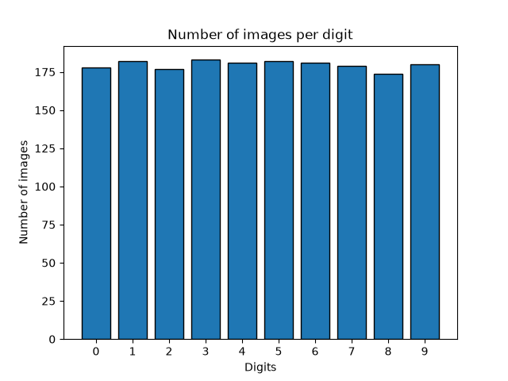
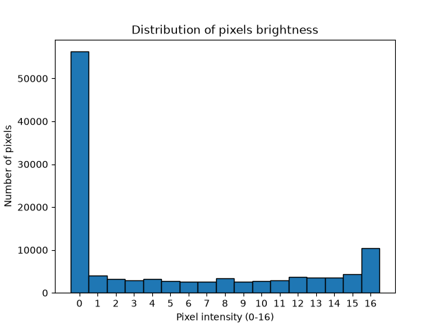
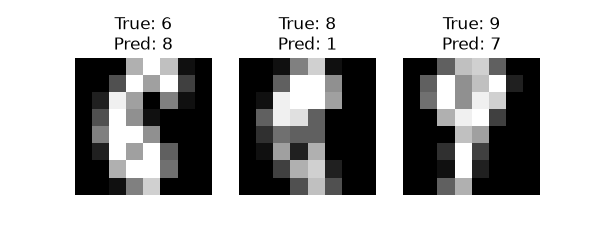
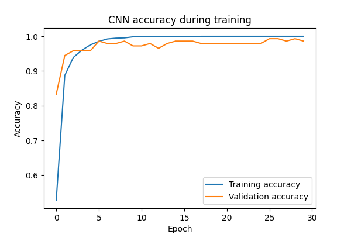
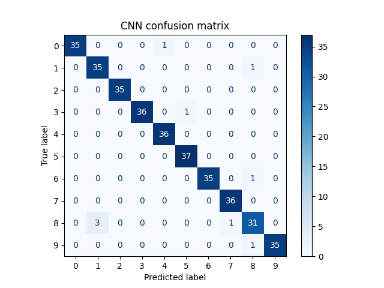
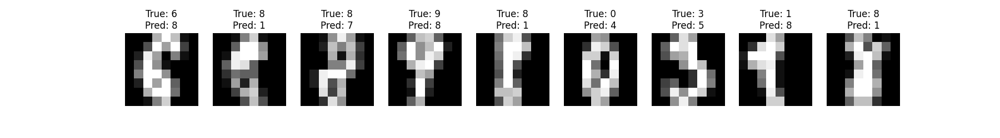
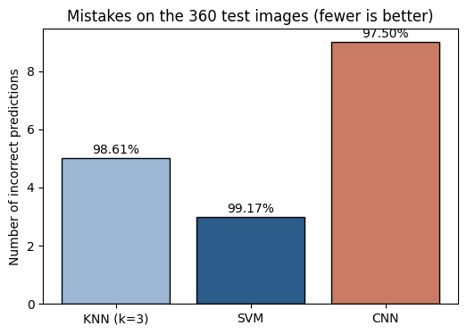

# CSCI6201-final-project-handwritten-digits
## Name of the team members:
Melina Ghyabi - Precious Ogundu

## Dataset Description:
**Dataset name:** Optical Recognition of Handwritten Digits (scikit-learn Digits) <br>
**Source:** scikit-learn <br>
**Dataset URL:** https://scikit-learn.org/stable/modules/generated/sklearn.datasets.load_digits.html <br>
**Task type:** classification

The dataset contains 1,797 grayscale images representing handwritten digits from 0 to 9. Each image has a resolution of 8×8 pixels, producing 64 numerical features per image. Pixel intensity values range from 0 to 16.

## Research Questions:

1. Which handwritten digits do the models confuse most often?
2. How accurately can a basic machine-learning model classify unseen handwritten digits using the pixel values of 8×8 images?
3. How do a simple model (KNN), a traditional model (SVM) and a deep learning model (CNN) compare on the same test images?

## Run in order:
``` powershell
python 01_load_digits.py
python 02_explore_digits.py
python 03_visualize_digits.py
python 04_classify_digits.py
python 05_svm.py
python 06_cnn.py
```

## Data exploring and analyze report:

The dataset was explored using Python, NumPy, and scikit-learn.<br>
The dataset contains approximately 174–183 images per digit, suggesting that the ten digit classes are relatively balanced. No missing pixel values were found.

| Characteristic      | Result |
|---------------------|--------|
| Number of samples   | 1,797  |
| Number of features  | 64     |
| Image dimensions    | 8 × 8  |
| Target classes      | 0–9    |
| Minimum pixel value | 0      |
| Maximum pixel value | 16     |
| Average pixel value | 4.88   |
| Standard deviation  | 6.02   |
| Missing values      | 0      |

## Data visualizations:

### Graph 1: Class distribution
This bar chart shows the number of images for each digit from 0 to 9. The counts are relatively similar, with digit 3 appearing most frequently (183 images) and digit 8 appearing least frequently (174 images).



### Graph 2: Pixel intensity distribution
This histogram shows the frequency of pixel intensity values from 0 to 16. Pixel intensity 0 occurs most frequently, indicating that a large portion of the images consists of dark background pixels.



## First basic model:

A k-Nearest Neighbors (KNN) classifier was used as the initial classification model.<br>
The dataset was divided into 80% training data and 20% testing data:

- Training samples: 1,437
- Testing samples: 360
- Number of neighbors (k): 3
- Random state: 42
- Stratified split: Yes

The model was trained using the training images and evaluated using previously unseen testing images.

**Accuracy: 98.61%**

The model correctly classified 355 of the 360 testing images and incorrectly classified 5 images.

This result suggests that the 64 pixel features provide useful information for identifying handwritten digits.

## Second model: Support Vector Machine (SVM)

An SVM was trained on the same 80/20 split as the KNN model (`05_svm.py`).

- The default SVM reached **99.17%** accuracy.
- The settings were then tuned with 5-fold cross-validation on the training data only (`GridSearchCV`), testing 12 combinations of `C` and `gamma`.
- Best settings: `C = 10`, `gamma = 0.001` (cross-validation accuracy: 98.96%).
- **Tuned SVM test accuracy: 99.17%**, with 3 incorrect predictions out of 360.

The SVM's three mistakes were a 6 read as an 8, an 8 read as a 1, and a 9 read as a 7.




## Third model: Convolutional Neural Network (CNN)

A CNN was built with TensorFlow/Keras (`06_cnn.py`). Unlike KNN and SVM, which treat each image as a flat list of 64 numbers, the CNN reads each image as an 8×8 grid, so it can learn shapes such as curves and lines.

**CNN test accuracy: 97.50%**, with 9 incorrect predictions out of 360.

The training curve shows that training accuracy reached 100% by epoch 18, while validation accuracy stayed around 97–99%. This gap suggests mild overfitting: the CNN learned the training images perfectly but did not generalize better than the simpler models.



The CNN's most common mistake was reading an 8 as a 1 (3 times).





## Model comparison

All three models were evaluated on the same 360 test images.

| Model | Accuracy | Macro F1 | Mistakes (of 360) |
|-------|----------|----------|-------------------|
| SVM (C=10, gamma=0.001) | 99.17% | 0.992 | 3 |
| KNN (k=3) | 98.61% | 0.986 | 5 |
| CNN | 97.50% | 0.975 | 9 |



**What the results show:**

- All three models classify more than 97% of the test digits correctly, so the 64 pixel values carry enough information to recognize handwritten digits well.
- The SVM performed best on this test set, with only 3 mistakes.
- The CNN, the most complex model, performed worst. With tiny 8×8 images and only 1,437 training images, it overfit the training data. A CNN's advantage is more likely to appear with larger, more detailed images or more training data.
- The differences between models are small (3 vs. 9 mistakes, about 1.7 percentage points) and come from a single train/test split. A different split could change the ranking slightly, so we do not claim that one model is better in general.

## Progress Notes:
- Loaded the Handwritten Digits dataset.
- Examined the dataset structure and descriptive statistics.
- Checked for missing values.
- Created `figures/class_distribution.png`, which shows the number of images for each digit from 0 to 9.
- Created `figures/pixel_distribution.png`, which shows the frequency of pixel intensity values from 0 to 16
- Trained a basic KNN classifier.
- Evaluated the classifier using a separate testing set.
- Trained and tuned an SVM classifier with cross-validation (99.17% accuracy).
- Built and trained a CNN with TensorFlow/Keras (97.50% accuracy).
- Compared all three models on the same test images using accuracy, macro F1, confusion matrices and misclassified images.
- Moved all code to local Python scripts so every model runs in the same environment.

## Conclusion:

All three models classified more than 97% of the test digits correctly. The SVM performed best (99.17%), followed by KNN (98.61%) and the CNN (97.50%).

## Answering the research questions:

**1. Which digits do the models confuse most often?**
Reading an 8 as a 1 was the most common mistake: 3 of KNN's 5 mistakes, 3 of the CNN's 9 and 1 of the SVM's 3. The digit 9 was also misread several times (as a 4, 7 or 8). At 8×8 resolution, these digits share similar strokes, which makes them harder to tell apart.

**2. How accurately can a basic model classify unseen digits?**
Very accurately. The KNN model correctly classified 355 of 360 unseen test images (98.61%), so the 64 pixel values carry enough information to recognize handwritten digits.

**3. How do KNN, SVM and CNN compare on the same test images?**
The SVM performed best (99.17%, 3 mistakes), followed by KNN (98.61%, 5 mistakes) and the CNN (97.50%, 9 mistakes). The CNN, the most complex model, overfit the small training set. On tiny 8×8 images, simpler models were enough. The gap between the models is small and comes from one test split, so we do not claim that one model is better in general.

**Limitation:** results come from a single test set of 360 images. In real mail sorting, even a small error rate means misrouted mail, so uncertain predictions would still need a human check.

## AI usage:
I used ChatGPT as a learning assistant. AI assistance included:
Explaining the dataset and data analysis techniques. Helping troubleshoot errors and GitHub troubleshooting. And also assisting with grammatical corrections and sentence polishing.

I also used Claude (Anthropic) as a learning assistant for choosing which models and metrics to compare, setting up the Python environment for TensorFlow, and converting the CNN notebook to a Python script.