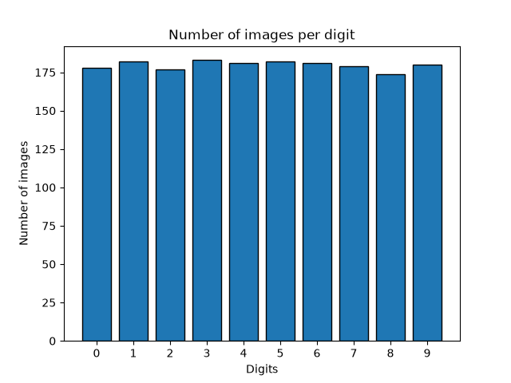
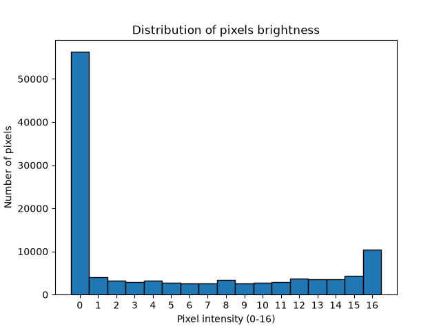

# csci6201-final-project-handwritten-digits

## Name of all team members: 
Melina Ghyabi - Precious Ogundu

## Dataset description: 
Optical Recognition of Handwritten Digits Dataset <br> <br>
The dataset contains 1797 grayscale images representing handwritten digits from 0 to 9. Each image has an 8x8 pixel resolution, producing 64 numerical features per image. Pixel intensity values (brightness) range from 0 to 16. <br> <br>
**source:** https://scikit-learn.org/stable/modules/generated/sklearn.datasets.load_digits.html <br> <br>
**task type:** classification

## Research questions:
1. How accurately can a machine-learning model classify handwritten digits using pixel intensity values?
2. Which handwritten digits are most frequently confused by the classification model?
3. How does the performance of different classification algorithms compare when recognizing handwritten digits?

##  Run in order:
```powershelgl
python -m pip install -r requirements.txt
python handwritten_digits/01_load_digits.py
python handwritten_digits/02_explore_digits.py
python handwritten_digits/03_visualize_digits.py
python handwritten_digits/04_classify_digits.py
```

## Dataset exploring report:
The dataset was explored using Python, NumPy, and Scikit-learn. <br>
The dataset contains approximately 174-183 images per digit, which suggests that the ten digit classes are relatively balanced. Also no missing pixel value was found.<br>
|Characteristic     |Results|
|-------------------|-------|
|Number of Samples  |1797   |
|Number of Features |64     |
|Image Dimensions   |8 x 8  |
|Target Classes     |0 - 9  |
|Minimum Pixel Value|0      |
|Maximum Pixel Value|16     |
|Average Pixel Value|4.88   |
|Standard Deviation |6.02   |
|Missing Value      |0      |

## Data Visualizations:
### Graph 1: Class Distribution 
This bar chart shows the number of images for each digit from 0 to 9. The counts are relatively similar, with digit 3 appearing most frequently (183 images) and digit 8 appearing least frequently (174 images).


### Graph 2: Pixel Intensity Distribution
This histogram shows the frequency of pixel intensity values from 0 to 16. Pixel intensity 0 occurs most frequently, indicating that a large portion of images consists of dark background pixels.


## First Basic model:
A K-Nearest Neighbors (KNN) classifier was used as the initial classification model.

The dataset was divided into 80% training data and 20% testing data:
- Training samples: 1437
- Testing samples: 360
- Number of neighbors (k): 3
- Random state: 42
- Stratified split: Yes

The model was trained using the training images and evaluated using previously unseen testing images.

**Perliminary Accuracy:** 98.61%

The model correctly classified 355 out of the 360 testing images and incorrectly classified 5 images. <br>
This result suggests that the 64 pixel features provide useful information for identifying handwritten digits. However additional evaluation is needed before drawing borders conclusions about model performance.

## Progress Notes:

### What is working so far?
- Loaded the Handwritten Digits dataset.
- Examined the dataset structure and descriptive statistics.
- Checked for missing values.
- Investigated class distribution and pixel intensity.
- Created two visualizations.
- Trained a basic KNN classifier with 98.61% accuracy.
- Evaluated the classifier using a separate testing set.

### What part of the project still needs work?
Further evaluation is needed to understand which handwritten digits are most frequently misclassified and why.

### What do you plan to add or improve before the Final Project?
We plan to investigate the model's mistakes using a confusion matrix, compare KNN with other classification methods, and experiment with model parameters to evaluate possible improvements.

### Is there anything you would specifically like instructor feedback on?
We would appreciate feedback on whether our proposed research questions are sufficiently focused and whether comparing different classification models would be an appropriate direction for the Final Project.

